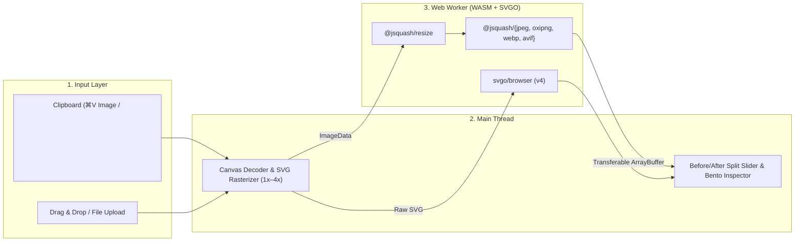

<div align="center">
  

  # Happier Image

  **100% Client-Side Image Converter & Optimizer for SVG, PNG, JPG, WebP, and AVIF**

  [](https://tanstack.com/start)
  [](https://react.dev)
  [](https://github.com/jamsinclair/jSquash)
  [](https://svgo.dev)
  [](https://tailwindcss.com)
  [](https://www.typescriptlang.org)
  [](https://github.com/happier-solutions/happier-image-converter)
</div>

---

## Overview

**Happier Image** is a fast, privacy-first web application that converts and optimizes vector (**SVG**) and raster (**PNG, JPG, WebP, AVIF**) images directly inside the browser.

Powered by **WebAssembly (`@jsquash/*`)**, **SVGO v4 (`svgo/browser`)**, and **Vite Web Workers**, all image encoding and optimization workloads run 100% locally on the user's device—zero server uploads, zero bandwidth cost, and instant interactive feedback.

---

## Key Features

- **100% Local & Offline-Ready**: Images never leave your browser. All codecs execute in background Web Workers via WebAssembly.
- **Universal Input Workflow**:
  - **Global Clipboard Paste (`⌘V` / `Ctrl+V`)**: Paste bitmap screenshots, copied image files, or raw `<svg>...</svg>` XML markup from anywhere on the page.
  - **Drag & Drop / File Picker**: Supports `.svg`, `.png`, `.jpg/.jpeg`, and `.webp`.
  - **1-Click Built-In Samples**: Instantly test vector SVG minification, transparent PNG lossless compression, and photographic JPEG/WebP/AVIF encoding.
- **Multi-Format Optimization & Conversion**:
  - **SVG → SVG**: Minify vector paths, strip editor metadata, collapse groups, and tune decimal float precision (`1–5`) with SVGO v4 multipass.
  - **SVG → Raster (`PNG`, `JPG`, `WebP`, `AVIF`)**: Rasterize vector graphics at `1x`, `2x`, `3x`, or `4x` resolution or custom pixel dimensions prior to WASM encoding.
  - **Raster → Raster (`PNG`, `JPG`, `WebP`, `AVIF`)**:
    - **MozJPEG (`@jsquash/jpeg`)**: High-efficiency lossy JPEG compression with custom background fill for transparent sources.
    - **OxiPNG (`@jsquash/oxipng`)**: Lossless PNG compression (`Level 1–6`) with alpha channel optimization.
    - **WebP (`@jsquash/webp`)**: Both lossy quality control and true lossless mode.
    - **AVIF (`@jsquash/avif`)**: Next-generation AV1 image coding with adjustable quality and encoding speed (`2–10`).
- **Interactive Inspection Studio**:
  - **Before / After Split Slider**: Smoothly drag across the canvas to compare original vs. optimized visual fidelity.
  - **Side-by-Side & SVG Code Inspector**: Inspect raw vs. minified SVG markup and character savings in real time.
  - **Canvas Backdrops & Zoom**: Switch between Checkerboard, Warm Paper, and Dark Slate backdrops with `50%–250%` zoom.
- **Craft.do-Inspired Aesthetic & Cultural Identity**:
  - Warm paper surfaces, frosted glass floating panels (`backdrop-blur`), tactile spring micro-animations on click, and a subtle **Đông Sơn Bronze Drum (Trống Đồng)** vector backdrop.
- **Bilingual i18n (`Tiếng Việt` & `English`)**:
  - Defaults to Vietnamese with automatic browser language detection that prompts English-speaking visitors to switch in one click.

---

## Architecture



---

## Tech Stack

| Layer | Technology |
| :--- | :--- |
| **Framework** | [TanStack Start 1.0](https://tanstack.com/start) (`@tanstack/react-start` + `@tanstack/react-router`, SPA / Static Prerender mode) |
| **UI Library** | [React 19](https://react.dev) + [Tailwind CSS v4](https://tailwindcss.com) + [Lucide Icons](https://lucide.dev) |
| **Raster WASM Codecs** | [`@jsquash/jpeg`](https://www.npmjs.com/package/@jsquash/jpeg), [`@jsquash/png`](https://www.npmjs.com/package/@jsquash/png), [`@jsquash/oxipng`](https://www.npmjs.com/package/@jsquash/oxipng), [`@jsquash/webp`](https://www.npmjs.com/package/@jsquash/webp), [`@jsquash/avif`](https://www.npmjs.com/package/@jsquash/avif), [`@jsquash/resize`](https://www.npmjs.com/package/@jsquash/resize) |
| **Vector Optimizer** | [`svgo`](https://github.com/svg/svgo) v4 (`svgo/browser`) |
| **Bundler** | [Vite 8](https://vite.dev) (ES Module Web Workers + WASM asset pipeline) |

---

## Getting Started

### Prerequisites

- **Node.js** `>= 20.0.0`
- **pnpm** `>= 9.0.0` (recommended)

### Installation

```bash
# Clone the repository
git clone git@github.com:happier-solutions/happier-image-converter.git
cd happier-image-converter

# Install dependencies
pnpm install
```

### Development

```bash
# Start the local development server on http://localhost:3000
pnpm run dev
```

### Production Build & Preview

```bash
# Type-check with TypeScript
pnpm exec tsc --noEmit

# Build production client & prerendered SPA bundle
pnpm run build

# Preview production build locally
pnpm run preview
```

---

## Project Structure

```text
├── public/
│   ├── favicon.svg                      # Happier Image squircle vector icon
│   └── site.webmanifest                 # Web App Manifest
├── src/
│   ├── components/
│   │   ├── AppLogoIcon.tsx              # Brand icon component
│   │   ├── ClickBurstOverlay.tsx        # Tactile click ripple & spark micro-animation
│   │   ├── CompareSlider.tsx            # Before/After split slider, Side-by-Side & SVG Code view
│   │   ├── DropPasteZone.tsx            # Drag & drop, ⌘V paste & 1-click samples
│   │   ├── LanguageSwitcher.tsx         # VI/EN dropdown pill & English suggestion banner
│   │   ├── OptimizationPanel.tsx        # Format selector, codec sliders & export summary
│   │   └── TrongDongBackdrop.tsx        # Đông Sơn bronze drum vector background
│   ├── i18n/
│   │   ├── index.tsx                    # Type-safe i18n context & browser locale detector
│   │   └── locales/
│   │       ├── en.ts                    # English dictionary
│   │       └── vi.ts                    # Vietnamese dictionary (default)
│   ├── lib/
│   │   └── image-decoder.ts             # Clipboard reader, SVG rasterizer & sample generator
│   ├── routes/
│   │   ├── __root.tsx                   # Root document shell, fonts & providers
│   │   └── index.tsx                    # Main studio workspace & Web Worker coordinator
│   ├── styles/
│   │   └── app.css                      # Craft.do design tokens, glass panels & spring physics
│   ├── types/
│   │   └── image.ts                     # Shared TypeScript interfaces for codecs & worker RPC
│   └── workers/
│       └── image-optimizer.worker.ts    # Dedicated Web Worker for jSquash WASM & SVGO v4
├── package.json
├── tsconfig.json
└── vite.config.ts
```

---

## License

Copyright © Happier Solutions. All rights reserved.
